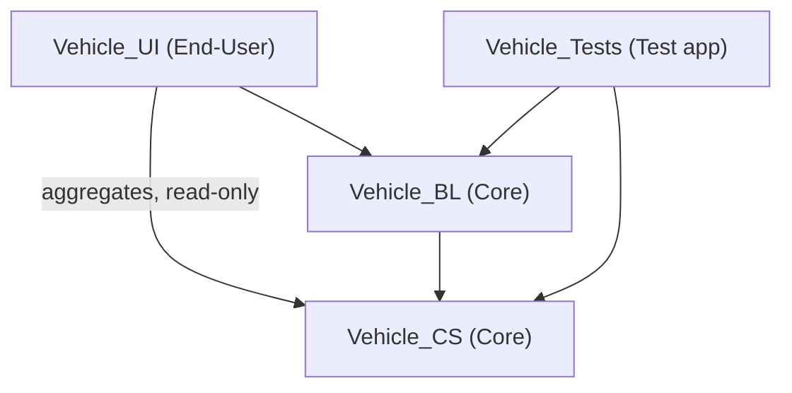
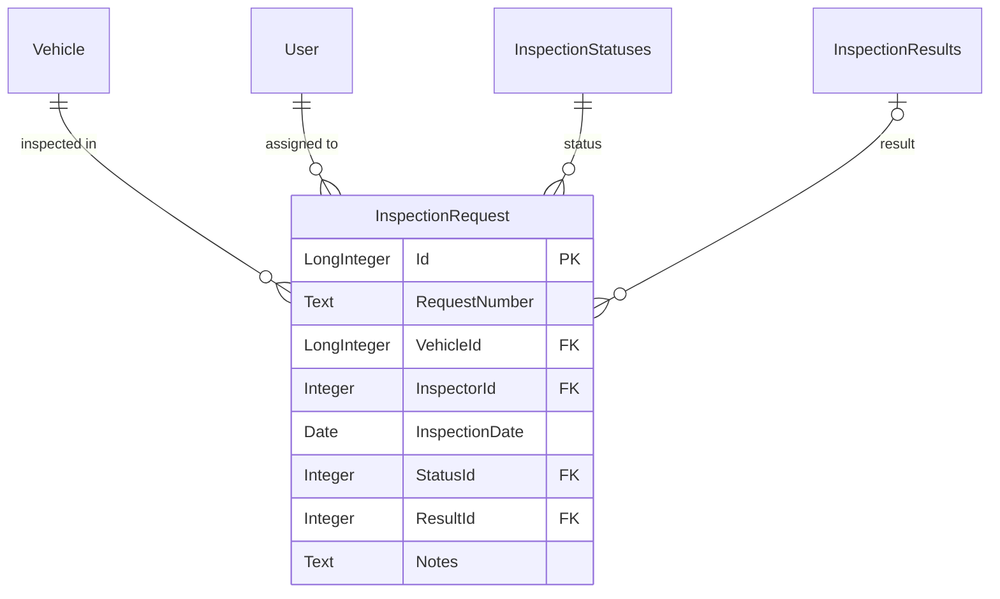
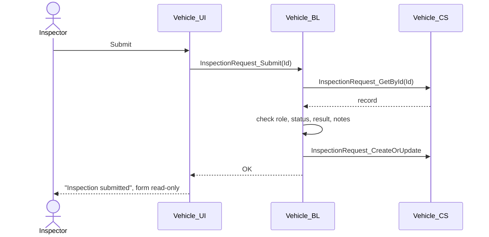
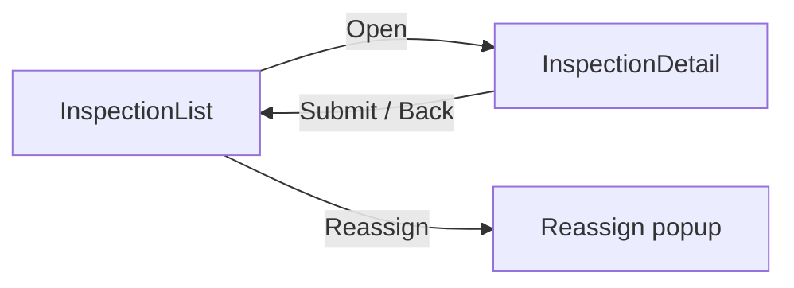

# 1. Document control

| Item | Value |
|---|---|
| Feature | Vehicle Inspection |
| Domain | Vehicle |
| Story / ticket | SAMPLE-123 |
| Version | 1.0 |
| Status | Draft |
| Author | Sample author |
| Reviewed by | Tech Lead |
| Date | 2026-10-22 |

# 2. Overview

## 2.1 User story

As an inspector I want to see the inspection requests assigned to me, open one, record the
result (Passed / Failed + notes) and submit it. Supervisors see all requests and can reassign
them to another inspector.

## 2.2 Acceptance criteria

1. A Failed result needs notes.
2. A submitted inspection cannot be changed.

## 2.3 Scope

- **In scope:** inspection list and detail screens, save draft, submit, reassign.
- **Out of scope:** creating inspection requests (another process); notifications.

## 2.4 Assumptions

1. Inspectors are OutSystems users with the Inspector role.
2. Reassign is a popup on the list screen.

# 3. Architecture

## 3.1 Modules

| Canvas layer | Module | Application | New / Changed | Elements in this feature |
|---|---|---|---|---|
| End-User | Vehicle_UI | Vehicle Portal | Changed | InspectionList, InspectionDetail |
| Core | Vehicle_BL | Vehicle Core | Changed | InspectionRequest_Save, _Submit, _Reassign |
| Core | Vehicle_CS | Vehicle Core | Changed | InspectionRequest, InspectionStatuses, InspectionResults, CRUD |
| Test | Vehicle_Tests | Vehicle Tests | Changed | 3 test screens |

## 3.2 Dependencies

## 3.3 New references

| From | To | Elements used | Rule check |
|---|---|---|---|
| Vehicle_UI | Vehicle_BL | InspectionRequest_Save, _Submit, _Reassign | OK — own domain `_BL` |
| Vehicle_UI | Vehicle_CS | InspectionRequest, static entities (read) | OK — read-only aggregates |
| Vehicle_BL | Vehicle_CS | InspectionRequest CRUD | OK — own domain `_CS` |

# 4. Data model

## 4.1 Entity relationship diagram

## 4.2 Entities

### InspectionRequest (Vehicle_CS)

A request to inspect one vehicle, assigned to one inspector.

| Attribute | Type | Length | Mandatory | Default | Description |
|---|---|---|---|---|---|
| Id | Long Integer | | Yes | | Primary key |
| RequestNumber | Text | 20 | Yes | | Business number shown to users |
| VehicleId | Vehicle Identifier | | Yes | | Vehicle to inspect |
| InspectorId | User Identifier | | Yes | | Inspector currently assigned |
| InspectionDate | Date | | Yes | | Planned inspection date |
| StatusId | InspectionStatuses Identifier | | Yes | Assigned | Status of the request |
| ResultId | InspectionResults Identifier | | No | | Outcome, empty until recorded |
| Notes | Text | 2000 | No | | Inspector notes; required when Failed |
| CreatedOn / CreatedBy | Date Time / User Identifier | | Yes | | Audit |
| UpdatedOn / UpdatedBy | Date Time / User Identifier | | No | | Audit |

- **Indexes:** RequestNumber (unique), InspectorId, StatusId, InspectionDate
- **Delete rules:** VehicleId — Protect
- **Exposed:** Public = Yes, Expose Read Only = Yes

## 4.3 Static entities

### InspectionStatuses

| Identifier | Label | Order | Description |
|---|---|---|---|
| Assigned | Assigned | 1 | Assigned to an inspector, not started |
| Draft | Draft | 2 | Result being recorded |
| Submitted | Submitted | 3 | Final; cannot be changed |

### InspectionResults

| Identifier | Label | Order | Description |
|---|---|---|---|
| Passed | Passed | 1 | Vehicle passed the inspection |
| Failed | Failed | 2 | Vehicle failed; notes required |

# 5. Business logic

## 5.1 Actions

### InspectionRequest_Submit (Vehicle_BL)

Submits a recorded inspection. After this it cannot be changed.

| Direction | Name | Type | Mandatory | Description |
|---|---|---|---|---|
| Input | InspectionRequestId | InspectionRequest Identifier | Yes | Request to submit |

**Roles:** Inspector, only the assigned inspector · **Transaction:** one transaction (server actions only)

**Steps**

1. Check the Inspector role and that the user is the assigned inspector.
2. Get the request with `InspectionRequest_GetById`.
3. Check the status is Draft and a result is recorded.
4. If the result is Failed, check that Notes is not empty.
5. Set StatusId = Submitted and save with `InspectionRequest_CreateOrUpdate`.

**Errors**

| Condition | Message |
|---|---|
| Not the assigned inspector | "You can only submit inspections assigned to you." |
| Status is not Draft | "Only draft inspections can be submitted." |
| No result | "Choose a result before submitting." |
| Failed without notes | "Notes are required when the inspection fails." |

*InspectionRequest_Save and InspectionRequest_Reassign follow the same layout.*

## 5.2 Main flow

# 6. Service actions and exposed APIs

Not applicable.

# 7. Integrations consumed

Not applicable.

# 8. User interface

## 8.1 Screens

| Screen | Module | Type | Roles | Data | Actions |
|---|---|---|---|---|---|
| InspectionList | Vehicle_UI | List | Inspector, Supervisor | Aggregate on InspectionRequest + Vehicle + User, page size 20 | Open → InspectionDetail; Reassign (popup) → InspectionRequest_Reassign |
| InspectionDetail | Vehicle_UI | Detail | Inspector | Aggregate by InspectionRequestId | Save draft → InspectionRequest_Save; Submit → InspectionRequest_Submit |

## 8.2 Blocks

Not applicable.

## 8.3 Screen flow

# 9. Security

| Role | InspectionList | InspectionDetail | Save / Submit | Reassign |
|---|---|---|---|---|
| Inspector | Own requests | Allowed | Allowed (assigned only) | Denied |
| Supervisor | All requests | Denied | Denied | Allowed |

# 10. Error handling and logging

- **Business errors:** User Exceptions with the messages in section 5.
- **Technical errors:** logged with `LogMessage` (ModuleName = Vehicle_BL) with the request Id; users see a generic message.
- **Personal data:** none logged.

# 11. Configuration

Not applicable. Timers: Not applicable.

# 12. Testing

| Test screen | Module | Scenarios | Last run | Result |
|---|---|---|---|---|
| InspectionRequest_Save_Tests | Vehicle_Tests | 4 | 2026-10-22 | 4 passed |
| InspectionRequest_Submit_Tests | Vehicle_Tests | 8 | 2026-10-22 | 8 passed |
| InspectionRequest_Reassign_Tests | Vehicle_Tests | 4 | 2026-10-22 | 4 passed |

# 13. Deployment

| Order | Application | Modules | Notes |
|---|---|---|---|
| 1 | Vehicle Core | Vehicle_CS, Vehicle_BL | |
| 2 | Vehicle Portal | Vehicle_UI | |
| — | Vehicle Tests | Vehicle_Tests | Development and Test only |

**Manual steps per environment:** grant the Inspector and Supervisor roles to the right users.

# 14. Issues and change log

## 14.1 Issues found

| # | Issue | Rule | Suggested fix |
|---|---|---|---|
| — | None | | |

## 14.2 Change log

| Version | Date | Author | Change |
|---|---|---|---|
| 1.0 | 2026-10-22 | Sample author | First version |
