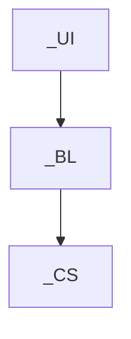
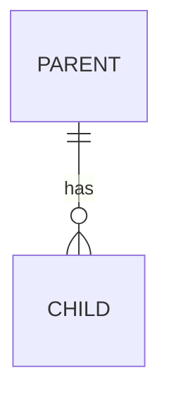
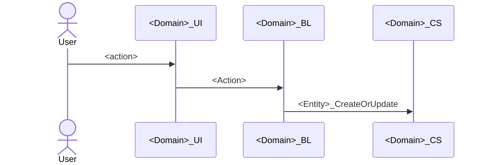
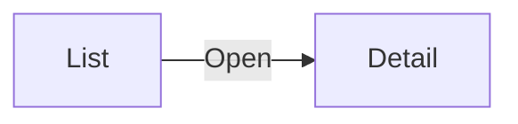

# 1. Document control

| Item | Value |
|---|---|
| Feature | <Feature name> |
| Domain | <Domain> |
| Story / ticket | <reference> |
| Version | 1.0 |
| Status | Draft |
| Author | <name> |
| Reviewed by | <Tech Lead> |
| Date | <YYYY-MM-DD> |

# 2. Overview

## 2.1 User story

<story text>

## 2.2 Acceptance criteria

1. <criterion>

## 2.3 Scope

- **In scope:** <...>
- **Out of scope:** <...>

## 2.4 Assumptions

1. <assumption>

# 3. Architecture

## 3.1 Modules

| Canvas layer | Module | Application | New / Changed | Elements in this feature |
|---|---|---|---|---|
| Core | <Domain>_CS | <App> | Changed | <entities> |

## 3.2 Dependencies

## 3.3 New references

| From | To | Elements used | Rule check |
|---|---|---|---|
| <module> | <module> | <elements> | OK (downward, no cycle) |

# 4. Data model

## 4.1 Entity relationship diagram

## 4.2 Entities

### <EntityName> (<Domain>_CS)

<description>

| Attribute | Type | Length | Mandatory | Default | Description |
|---|---|---|---|---|---|
| Id | Long Integer | | Yes | | Primary key |

- **Indexes:** <...>
- **Delete rules:** <...>
- **Exposed:** Public = Yes, Expose Read Only = Yes

## 4.3 Static entities

### <StaticEntityName>

| Identifier | Label | Order | Description |
|---|---|---|---|
| <Id> | <Label> | 1 | <...> |

# 5. Business logic

## 5.1 Actions

### <ActionName> (<Domain>_BL)

<purpose>

| Direction | Name | Type | Mandatory | Description |
|---|---|---|---|---|
| Input | <name> | <type> | Yes | <...> |

**Roles:** <roles> · **Transaction:** <one transaction / calls service actions (see risks)>

**Steps**

1. <step>

**Errors**

| Condition | Message |
|---|---|
| <condition> | "<User Exception message>" |

## 5.2 Main flow

# 6. Service actions and exposed APIs

Not applicable.

# 7. Integrations consumed

Not applicable.

# 8. User interface

## 8.1 Screens

| Screen | Module | Type | Roles | Data | Actions |
|---|---|---|---|---|---|
| <Screen> | <Domain>_UI | List | <roles> | <aggregates> | <buttons → actions> |

## 8.2 Blocks

Not applicable.

## 8.3 Screen flow

# 9. Security

| Role | <Screen / action> | <Screen / action> |
|---|---|---|
| <Role> | Allowed | Denied |

# 10. Error handling and logging

- **Business errors:** User Exceptions with the messages in section 5.
- **Technical errors:** logged with `LogMessage` (ModuleName = <module>); users see a generic message.
- **Personal data:** none logged.

# 11. Configuration

| Site Property / Setting | Module | Purpose | Per environment |
|---|---|---|---|
| <name> | <module> | <purpose> | Yes / No |

Timers: Not applicable.

# 12. Testing

| Test screen | Module | Scenarios | Last run | Result |
|---|---|---|---|---|
| <Action>_Tests | <Domain>_Tests | <n> | <YYYY-MM-DD> | <n> passed |

# 13. Deployment

| Order | Application | Modules | Notes |
|---|---|---|---|
| 1 | <App> | <Domain>_CS, <Domain>_BL, <Domain>_UI | |

**Manual steps per environment:** <Site Property values, roles to grant, none>

# 14. Issues and change log

## 14.1 Issues found

| # | Issue | Rule | Suggested fix |
|---|---|---|---|
| — | None | | |

## 14.2 Change log

| Version | Date | Author | Change |
|---|---|---|---|
| 1.0 | <YYYY-MM-DD> | <name> | First version |
